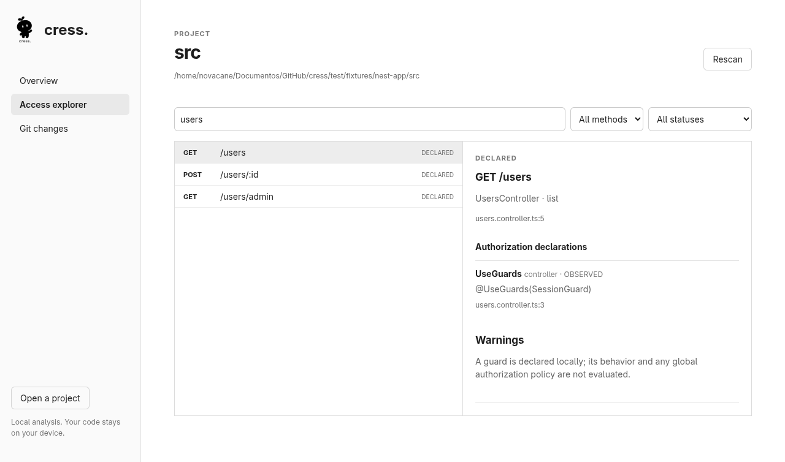

# Cress

Cress is a local-first desktop tool for exploring NestJS, Next.js API, and Go/Chi route authorization declarations and reviewing changes between Git revisions. It reports what it observes in source; it does not determine runtime access or scan for vulnerabilities.



## Desktop application

Download the appropriate unsigned package from the artifacts of a successful [GitHub Actions run](https://github.com/lucasonline0/cress/actions). Linux builds produce an AppImage; Windows and macOS builds are attempted in CI. Platform availability depends on the corresponding job succeeding. On Linux, the official one-command installer adds an application-menu entry and handles later AppImage updates. Standalone AppImages can also be launched manually after making them executable. AppImage requires a compatible Linux desktop and FUSE; it can also be extracted with `--appimage-extract`. Unsigned Windows and macOS builds may trigger SmartScreen or Gatekeeper warnings.

Choose **Open a project** and select a project directory. The access explorer searches routes and shows declarations with source locations. In **Git changes**, enter a local branch, tag, or commit and compare it with the working tree. Git must be installed for comparisons; scanning does not require Git. Export scan JSON from the overview, or diff JSON and offline HTML from the changes view. Choose an export destination outside the analyzed project.

Analysis stays on your computer and does not execute the project. Dynamic expressions, custom decorators, global guards, middleware, and runtime policy behavior can make effective authorization unknown. No missing guard or removed declaration proves that a route is public or vulnerable. Git comparison does not fetch remotes. Source symlinks are skipped.

## Analysis coverage and limitations

Cress discovers applications from package manifests and Go modules, and can find NestJS controllers in a directory without a manifest. Mixed repositories are analyzed by application root. Generated and dependency directories are skipped. A supported framework with no recognized API routes is distinct from an unsupported project; neither proves that the project has no endpoints.

- **NestJS:** literal controller and HTTP method decorators, guards, roles, public markers and observed global guard or metadata declarations. Dynamic expressions and custom semantics require review.
- **Next.js:** App Router `app/api/**/route` and Pages Router `pages/api/**` files, including supported JavaScript and TypeScript extensions and dynamic segments. Pages Router methods are unresolved except for supported explicit switch cases with a rejecting default. Authorization-related calls and middleware matcher declarations are observations, not proof of enforcement. Middleware applicability, indirect exports and runtime behavior are not fully resolved.
- **Go/Chi:** direct router registrations and lexically nested route groups, middleware, and route-local `With` chains. Same-function named mounts and direct router-parameter helpers within the local Go module are recognized; dynamic registrations, other mounts, router aliases, indirect cross-package construction and custom middleware behavior may be unresolved. Go itself is not required to run Cress.

Git comparison uses local Git tree contents and the working tree. It does not check out or fetch a revision. Route moves, duplicate identities and dynamic constructs may be ambiguous; review source references. Reports are offline and do not establish runtime access.

### JSON schema

Scan and diff JSON now use `schemaVersion: 2`. Scan output contains `applications`, framework-neutral `routes`, `globalDeclarations`, and `warnings`; NestJS-only details appear in each NestJS route's `nestjs` field. Diff output contains framework and application identity alongside before/after source observations. Consumers of version 1 fields such as `findings` must migrate to `routes`. A route's declarations represent source observations rather than effective authorization.

## Install on Linux

On Linux x86_64, use the official installer after confirming the published endpoint:

```sh
curl -fsSL https://getcress.vercel.app/install.sh | bash
```

Cress checks official GitHub Releases for updates and verifies the published AppImage SHA-256 before installing. The public website manifest continues to provide the one-command Linux installer with its stable version. When a newer version is published, the top-right **New update** control offers a confirmed, checksum-verified user-local installation and restarts the application. Standalone AppImages can migrate into the managed installation. Windows and macOS builds are currently distributed as unsigned packages; automated installation is not supported there.

For installation details and checksum limitations, see [Linux installation](docs/linux-installation.md).

## Development

Requires Git and Node.js 22.12 or later. Electron 45's binary must be installed explicitly after npm installation:

```sh
npm ci
npx install-electron
npm run desktop:dev
```

For checks and packaging:

```sh
npm run typecheck
npm run desktop:typecheck
npm run lint
npm test
npm run build
npm run desktop:smoke
npm run desktop:package -- --linux --x64
```

The GUI smoke test requires a desktop display (on Linux, `xvfb-run -a npm run desktop:smoke` can provide one). It tests actual Electron interaction with native dialog responses mocked. Build output is under `release/`. The package includes Electron and needs no system Node installation.

## CLI

```sh
npm run build
node dist/cli.js scan path/to/project
node dist/cli.js scan path/to/project --format json
node dist/cli.js diff path/to/project --base main
node dist/cli.js report path/to/project --base main --output report.html
```

See `--help` for command options. Contributions are welcome; see [CONTRIBUTING.md](CONTRIBUTING.md). MIT licensed.

### Expected access review in CI

Add a `.cress.json` at the project root. Policies match an exact framework, method, and route path; add `application` when multiple applications expose the same route. Each required declaration is matched as a source expression or identifier in the route's observed declarations.

```json
{
  "policies": [{
    "framework": "go-chi",
    "method": "POST",
    "path": "/v1/admin/users",
    "requiredDeclarations": ["requireRuntimeAdminAuth"]
  }]
}
```

Run `cress check . --base main`, or add `--format json` for machine-readable output. `PASS` means all declarations were observed, not that runtime access is proven. `REVIEW_REQUIRED` means an expected declaration observed at the baseline is no longer observed on the matching route. `UNKNOWN` means the route or declaration could not be established with sufficient coverage. Other authorization may exist. Exit codes: `0` for no verified divergence (including unknowns), `3` for a review-required divergence, `1` for an analysis, Git or configuration error, and `2` for invalid command options.

Example GitHub Actions step (ensure the base branch is fetched):

```yaml
- uses: actions/checkout@v4
  with:
    fetch-depth: 0
- uses: actions/setup-node@v4
  with:
    node-version: 22
- run: npm ci && npm run build
- run: node dist/cli.js check . --base origin/main
```
